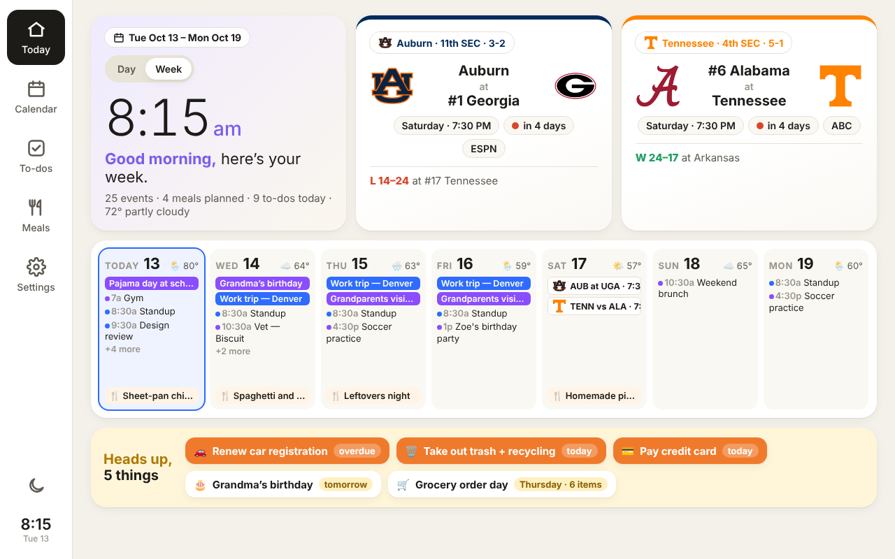
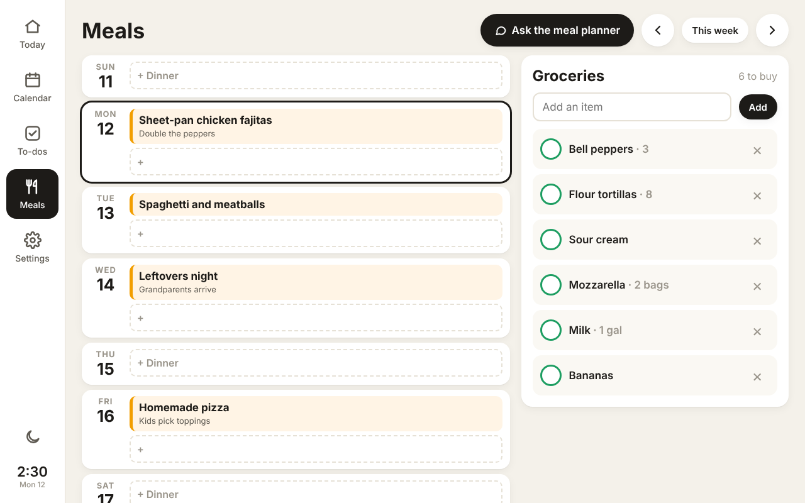
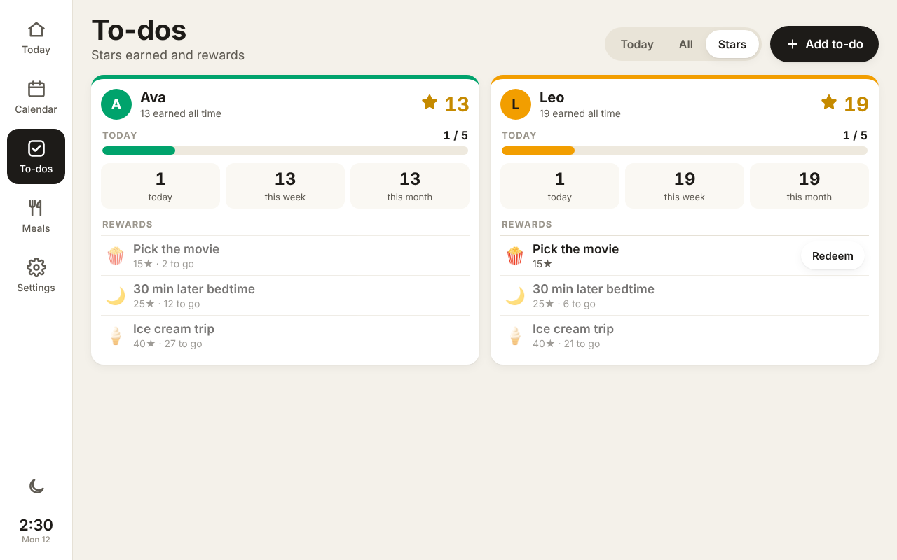
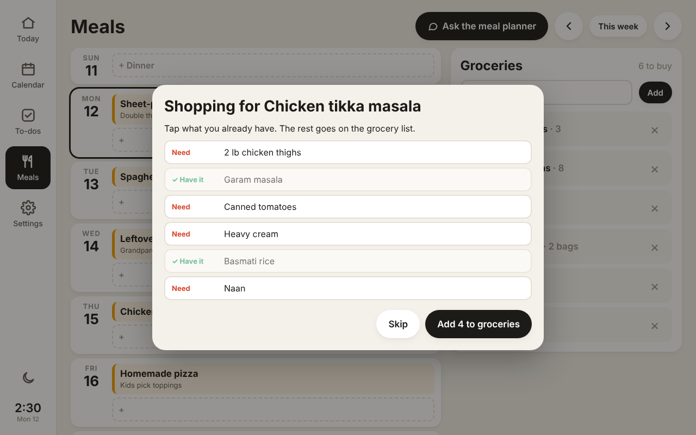

# Home Hub

A Skylight-style family wall display for a cheap Android photo frame (or any tablet, or a
browser), plus the same app on everyone's phone. It has:

- **Every Google Calendar you care about, merged**: yours, a partner's, a shared family calendar, a
  kid's school calendar, even from different Google accounts. Repeating events, moved and cancelled
  instances, all-day and multi-day events, and time zones are all handled. If the same invite is
  on two calendars, it shows once.
- **To-dos, recurring and one-time**, per person or "Anyone": daily, every N days, weekly on chosen
  days, every other week, monthly (including "last day of the month"), yearly, with optional
  start and end dates. One-time to-dos can have a due date and turn red when overdue. Group them
  by morning, afternoon or evening.
- **Stars for kids**: starred to-dos earn stars with a confetti (or star-shower) animation, a
  daily goal with a bigger celebration, today / this week / this month totals, and rewards the
  kids can spend stars on ("Pick the movie · 15★").
- **Meal planning**: a week of breakfasts, lunches, dinners and snacks (you choose which). Paste
  a recipe link and it reads the ingredients. Then tap what you already have, and the rest goes on
  the **grocery list**. Tonight's dinner shows on the Today screen.
- **A meal-planning assistant you can text** (powered by Claude): send it a meal idea or a recipe
  link. It tells you which days are open, asks which day and which meal, checks which ingredients
  you already have, then plans the meal and adds the rest to the grocery list. The same assistant
  is in the app, under Meals → Ask the meal planner.
- **A weekly grocery-order reminder by text** (Thursdays, or whichever day you pick) with the
  list and the week's meals.
- **Parent lock**: with a PIN set, kids can look and tick things off on the wall display, but
  adding, editing, rewards and Settings need the PIN.
- **Sleep and brightness**: dims, or shows only a dim clock, overnight; brightness changes through
  the day; tap the moon to sleep it any time. With the included kiosk app, this controls the
  frame's real backlight, and "Automatic" uses its light sensor if it has one.
- **A Day / Week home screen.** Day: today's agenda, dinner, to-dos and a "Heads up" strip.
  Week: a tile overview with the coming 7 days (events, weather, dinners, game days), your teams,
  and what's coming up (birthdays, trash night, overdue to-dos, rain, grocery-order day).
- **Sports tiles** for your teams (set to Auburn and Tennessee football; add any college football,
  NFL, NBA, MLB, NHL or college basketball team in Settings): record, conference standing, last
  result, next game with kickoff time and TV channel, and **live scores on game day**. Data comes
  from ESPN's free public feed, no key needed.
- Weather, a week and month calendar, and one shared, live copy for every screen. Changes on a
  phone show on the frame within a minute.

It's built to run on the frames in
[wesbos/photo-frame-dashboard](https://github.com/wesbos/photo-frame-dashboard). That repo is the
guide for taking over the frame itself (ADB, root, WebView upgrade). Its dashboard uses mock data,
so this project supplies the real data. No code is copied from it (that repo has no license).
See [docs/device-setup.md](docs/device-setup.md) for the frame side.



| Meals and groceries | Stars and rewards | Calendar week |
| --- | --- | --- |
|  |  |  |

| Home, Day view | What do you already have? | To-dos |
| --- | --- | --- |
|  |  |  |

## Try it now, on your computer

Needs Node 20+.

```sh
npm install
npm run demo        # sample family, to-dos and two calendars; open http://localhost:5173
```

`npm run dev` is the same server with your own data, kept in `.data/home-hub.json`. Any phone,
tablet or frame on your Wi-Fi can open the address it prints. That's a quick way to test a frame
before anything is deployed.

```sh
npm test            # recurrence rules, calendar parsing (DST, moved/cancelled events), API
```

## How it fits together

```
 Photo frame (Home Hub kiosk app) ─┐
 Everyone's phones and laptops ────┼──>  Vercel: public/ (the app) + api/ (one function)
 Text messages (Twilio) ───────────┘         ├─ reads each Google Calendar's secret iCal feed
                                             ├─ stores to-dos, meals, groceries, stars in Supabase
                                             └─ runs the meal-planning assistant (Claude API)
```

- **One shared household.** Every screen (the frame, phones, laptops) uses the same household
  key, so everyone sees and edits the same to-dos, meals and grocery list. On each phone, choose
  **Settings → This device → Who uses this device?** so what you add is marked as yours and the
  assistant knows who it's talking to. There are no separate passwords per person.
- **Calendars are read-only for now.** Add and edit events in Google Calendar as usual (on your
  phone, as today); the display picks up changes within about 5–10 minutes. Because it reads each
  calendar's *secret iCal address*, there's no Google developer setup and no logins that expire.
- **The frame never holds secrets.** Calendar addresses, phone numbers and the API keys stay on
  the server. The display only knows the household key, which you enter once.
- **No build step.** `public/` is plain HTML/CSS/JS, written for the old Android WebView on these
  frames (Chrome/WebView 84+; the wesbos guide upgrades them to 106).

## Set it up (all of this can be done before the frame arrives)

### 1. Database: Supabase (free tier is plenty)

1. Create a project at [supabase.com](https://supabase.com). A dedicated project is cleanest.
   The tables are prefixed `hub_`, so an existing project also works.
2. **SQL Editor** → paste [`supabase/schema.sql`](supabase/schema.sql) → **Run**.
3. **Project Settings → API**: copy the **Project URL** and the **service_role** key (keep that
   one secret: it goes only into Vercel).

Free Supabase projects pause after a week with no activity. The display checks in every minute,
so it stays awake once the frame is up.

### 2. Hosting: Vercel (free Hobby plan)

1. [vercel.com/new](https://vercel.com/new) → import this repository. Framework preset: **Other**.
   Leave the build settings empty.
2. Add **Environment Variables**:

   | Name | Value |
   | --- | --- |
   | `ACCESS_KEY` | a long random string, e.g. from `openssl rand -hex 16`. It's the household key. |
   | `SUPABASE_URL` | Project URL from step 1 |
   | `SUPABASE_SERVICE_ROLE_KEY` | service_role key from step 1 |
   | `ANTHROPIC_API_KEY` | *(for the meal planner)* from [console.anthropic.com](https://console.anthropic.com) → API keys |
   | `PUBLIC_URL` | *(for texting)* `https://<your-app>.vercel.app`, no trailing slash |
   | `TWILIO_ACCOUNT_SID`, `TWILIO_AUTH_TOKEN`, `TWILIO_FROM` | *(for texting)* see step 5 |
   | `CRON_SECRET` | *(for the grocery reminder)* another random string. Vercel's daily job sends it automatically. |

3. Deploy. `https://<your-app>.vercel.app/api/health` should say `"storage":"supabase"`, and
   `"assistant":true` / `"sms":true` once those are set up.

### 3. Open it on your phone and fill in Settings

Open `https://<your-app>.vercel.app/?key=<ACCESS_KEY>` once. The key is remembered and removed
from the address bar. Add it to your home screen, since this is also how you'll add to-dos from
the couch. Then go to **Settings**:

- **Household**: name, time zone, weather location (search by city), °F/°C, which day the week
  starts, and when the screen dims at night.
- **People**: everyone who gets to-dos, each with a colour. Turn on **Stars** for kids.
  **Save** before linking calendars to people.
- **Google Calendars**: one entry per calendar (below).

### 4. Get each Google Calendar's secret address

On a computer (the Google Calendar phone app doesn't show it):

1. [calendar.google.com](https://calendar.google.com) → gear icon → **Settings**.
2. Under **Settings for my calendars** (left side), click the calendar.
3. **Integrate calendar** → copy **Secret address in iCal format**
   (`https://calendar.google.com/calendar/ical/…/private-…/basic.ics`).
4. Paste it into Home Hub's Settings, give it a name and colour, and pick whose it is (that
   person's initial then shows on its events).

Repeat for every calendar and every family member's account. Notes:

- For a calendar someone **shared with you**, the secret address only appears if you can
  "Make changes and manage sharing". Otherwise ask its owner to send you theirs.
- Some Google Workspace (work or school) accounts have the secret address turned off by the admin.
  Fallback: share that calendar to your personal Google account, then use the personal copy's
  address if it appears, or add the work account's **public** address if the calendar is public.
- Treat the address like a password. If one leaks, **Reset** it in Google and paste the new one.
  A feed that stops working shows a red notice on the Calendar screen.
- Holidays: add Google's "Holidays in United States" calendar to your account, then use its
  address the same way. It's public, so use **Public address in iCal format** instead.

### 5. Texting the meal planner (optional)

The assistant works in the app as soon as `ANTHROPIC_API_KEY` is set. To also **text** it, and to
get the grocery-order reminder by text, you need a phone number from
[Twilio](https://www.twilio.com):

1. Sign up, buy a local number with SMS (a dollar or so a month, plus a fraction of a cent per
   text).
2. **Register it for texting in the US** (Twilio Console → Messaging → Regulatory Compliance → A2P
   10DLC → "Sole proprietor" or "Low-volume standard"). US carriers block texts from unregistered
   numbers. Registration costs a few dollars and approval can take several days, so start early.
   A toll-free number with "toll-free verification" is the alternative.
3. Put the Account SID, Auth Token and the number (`+15551234567`) into Vercel as `TWILIO_ACCOUNT_SID`,
   `TWILIO_AUTH_TOKEN` and `TWILIO_FROM`, and set `PUBLIC_URL`. Redeploy.
4. In Twilio, open the number → Messaging configuration → "A message comes in": **Webhook**,
   `https://<your-app>.vercel.app/api/sms`, HTTP POST.
5. In Home Hub **Settings → People**, add the mobile number of everyone who may text it. Texts
   from any other number are ignored.
6. In **Settings → Meals and groceries**, turn on the grocery reminder, pick the day and who gets
   it. It goes out each morning around 8–9 a.m. US Central (the daily job runs at 14:00 UTC; change
   `crons` in `vercel.json` to move it).

An example exchange:

> **You:** https://www.allrecipes.com/recipe/…/chicken-tikka-masala/
> **Home Hub:** Chicken tikka masala, nice! Dinner is open Tuesday the 13th, Thursday the 15th and
> Saturday the 17th (Wednesday is busy, with soccer until 6). Which night? Do you already have
> chicken thighs, garam masala, canned tomatoes, heavy cream or basmati rice?
> **You:** Thursday. We have rice and garam masala
> **Home Hub:** Done: tikka masala Thursday for dinner. Added chicken thighs, canned tomatoes and
> heavy cream to the grocery list.

**Cost:** the assistant uses Claude Opus 5.5 at low effort. Planning a meal takes a few short
back-and-forth messages, which typically costs a few cents. To spend less, set
`HUB_AGENT_MODEL=claude-haiku-5-5` in Vercel; it's much cheaper, but not as good at
follow-up questions. If Claude declines a message for safety reasons, the request is retried
automatically on Anthropic's recommended fallback model (the API's `fallbacks: "default"`
option).

## Using it

- **Today**: switch between **Day** and **Week** at the top. Day shows tonight's dinner, the
  day's events and to-dos, weather, and this week's games. Week shows the tiles: tap a day to open
  it in the calendar. Tap an event for details.
  Tap the circle to tick off a to-do; you can undo from the toast. "Anyone" to-dos ask who did it,
  so the right kid gets the stars.
- **Calendar**: week and month views. Tap a month day to jump to its week. The chips at the top
  hide or show calendars on this screen only.
- **To-dos**: **Add to-do** to create one. **Press and hold** a to-do to edit or delete it. **All**
  lists everything, including repeating to-dos that aren't due today. **Stars** shows each kid's
  stars and rewards; **Redeem** spends them.
- **Meals**: tap **+** on a day to add a meal. Paste a recipe link and tap **Read recipe** to fill
  in the name and ingredients. After saving, tap what you already have; the rest goes on the
  grocery list. Tap a meal to see it, move it, or shop for it again. The grocery list is on the
  right: add items, tick them off in the store, then **Clear checked**.
- **Settings** (easiest from a phone): people and their phone numbers, calendars, meals to plan,
  grocery reminder, star goal and rewards, sleep and brightness, the parent PIN, and who uses
  this device.
- **Parent lock**: set a PIN in Settings. The kiosk app locks the frame automatically; any other
  screen can be locked with "Lock this screen". Once the PIN is entered, the screen stays unlocked
  for 5 minutes.
- **Sleep**: the moon in the sidebar sleeps the screen; a tap wakes it. At night it sleeps on its
  own (dim, or a dim clock), and it returns to Today after 3 idle minutes. It also reloads itself
  each night to pick up updates, and keeps showing the last data if Wi-Fi drops.

## How to-dos repeat

| Repeat | Shows up |
| --- | --- |
| One-time, no date | every day until it's ticked off |
| One-time, due date | from 14 days before it's due; red after the due date until ticked off |
| Daily, every N days | every N days from the start date |
| Weekly | on the chosen weekdays, every N weeks (counted from the start date's week) |
| Monthly | on day D every N months; day 31 or "Last day" means the month's last day |
| Yearly | on the start date's month and day (Feb 29 falls back to Feb 28) |

Repeating to-dos don't carry over: if Monday's isn't done, Tuesday starts fresh. A one-time to-do
ticked off today stays on screen, crossed out, until midnight. Deleting a to-do keeps its history
(and stars earned).

## API

All routes need the header `x-hub-key: <ACCESS_KEY>` except `/api/health`, the Twilio webhook
(checked with Twilio's signature) and the daily job (checked with `CRON_SECRET`). See the top of
[`lib/api.js`](lib/api.js) for the full list (`/api/state`, `/api/events`, `/api/tasks`,
`/api/meals`, `/api/groceries`, `/api/assistant`, …). That makes it easy to hook up an iOS Shortcut
("add milk to the grocery list"), Home Assistant, or a script later.

## Project layout

```
public/            the app (index.html, app.js, app.css) — no build step
api/index.js       Vercel function; every /api/* route goes here
lib/calendar.js    iCal fetch, recurrence expansion, time zones, de-duplication
lib/schedule.js    to-do recurrence rules
lib/meals.js       meal plan and grocery list
lib/recipes.js     reads recipe links (schema.org Recipe data)
lib/sports.js      team schedules, scores and records (ESPN public API)
lib/agent.js       the meal-planning assistant (Claude API tool loop)
lib/sms.js         Twilio: signature check, sending
lib/store.js       Supabase or local JSON file storage
lib/api.js         routes, validation, household key, parent PIN, stars
supabase/schema.sql
kiosk/             Android kiosk app for the frame (built by GitHub Actions)
scripts/           local dev server and demo data
docs/              device setup, screenshots
```

## Ideas for later

- **Adding calendar events from the app.** Today you add events in Google Calendar itself. Writing
  to Google from Home Hub needs a small Google Cloud setup (a service account that your family
  calendar is shared with); ask and it can be added.
- Photo slideshow when idle (Google Photos' API no longer allows reading albums, so this would use
  a shared folder or uploads instead).
- Grocery list sharing to Instacart / Walmart; recipe box of favourites; leftovers tracking.
