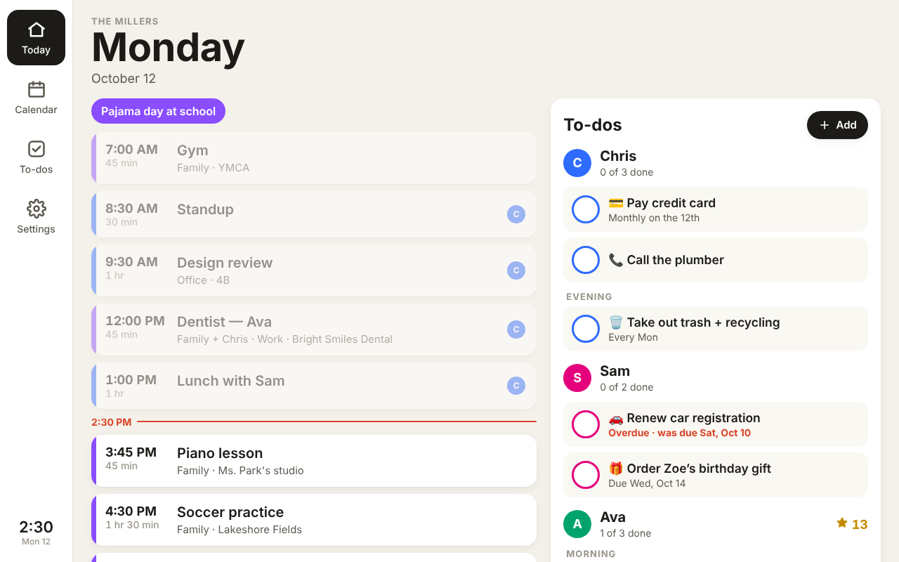
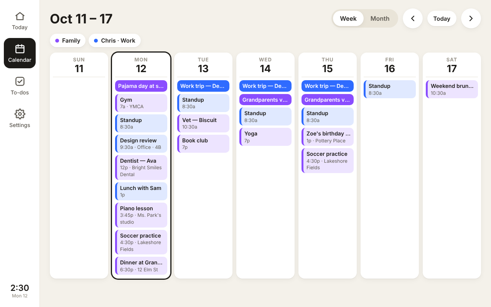
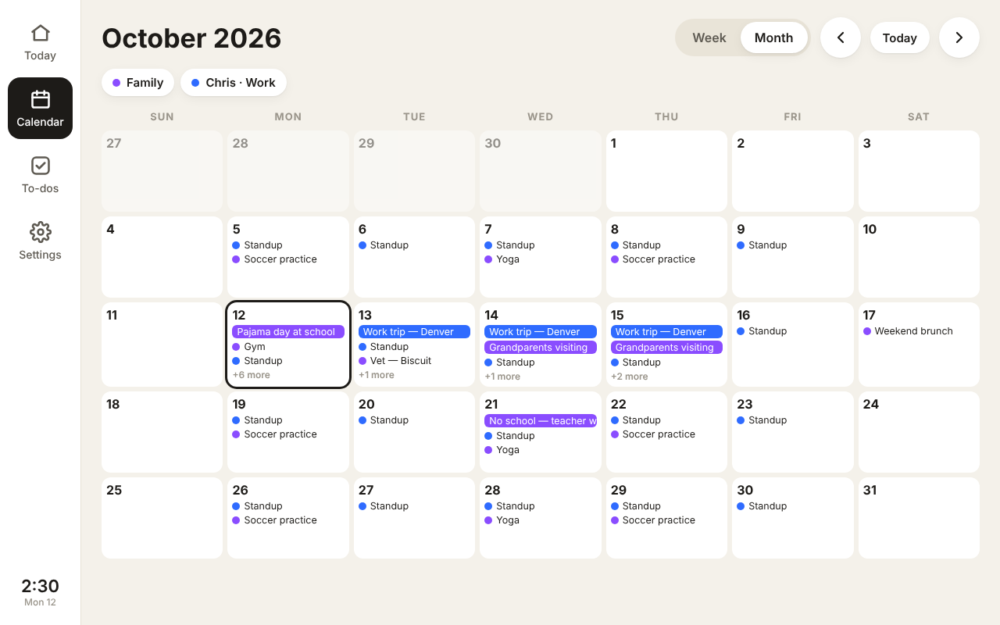
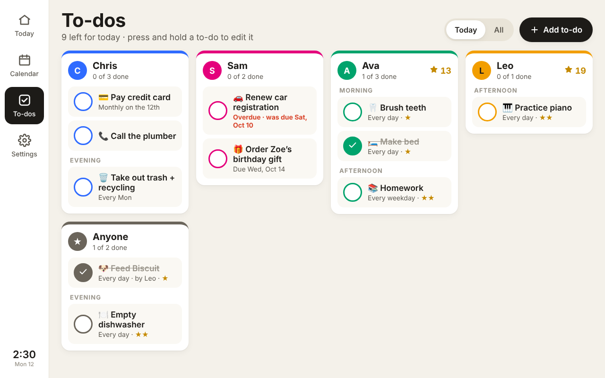

# Home Hub

A Skylight-style family wall display for a cheap Android photo frame (or any tablet, or a
browser). It shows:

- **Every Google Calendar you care about, merged**: yours, a partner's, a shared family calendar, a
  kid's school calendar, even from different Google accounts. Repeating events, moved and cancelled
  instances, all-day and multi-day events, and time zones are all handled. If the same invite is
  on two calendars, it shows once.
- **To-dos, recurring and one-time**, per person or "Anyone": daily, every N days, weekly on chosen
  days, every other week, monthly (including "last day of the month"), yearly, with optional
  start and end dates. One-time to-dos can have a due date and turn red when overdue. Group them
  by morning, afternoon or evening. Kids can earn stars.
- Today view (agenda, a "now" line, tomorrow's preview, weather), week and month calendars,
  dimming at night, and a settings page you use from your phone.

It's built to run on the frames in
[wesbos/photo-frame-dashboard](https://github.com/wesbos/photo-frame-dashboard). That repo is the
guide for taking over the frame itself (ADB, root, WebView upgrade, kiosk app). Its dashboard
uses mock data, so this project supplies the real data and to-dos. No code is copied from it
(that repo has no license). See [docs/device-setup.md](docs/device-setup.md) for the frame side.



| Week | Month | To-dos |
| --- | --- | --- |
|  |  |  |

## Try it now, on your computer

Needs Node 20+.

```sh
npm install
npm run demo        # sample family, to-dos and two calendars; open http://localhost:5173
```

`npm run dev` is the same server with your own data, kept in `.data/home-hub.json`. Any phone,
tablet or frame on your Wi-Fi can open the address it prints. That's a quick way to test a frame
before anything is deployed.

```sh
npm test            # recurrence rules, calendar parsing (DST, moved/cancelled events), API
```

## How it fits together

```
 Photo frame (kiosk WebView) ─┐
 Your phone's browser ────────┼──>  Vercel: public/ (the app) + api/ (one function)
                              │         ├─ fetches each Google Calendar's secret iCal feed
                              │         └─ reads and writes to-dos in Supabase (Postgres)
```

- **Calendars are read-only.** Add and edit events in Google Calendar as usual; the display picks
  up changes within about 5–10 minutes. Because it reads each calendar's *secret iCal address*,
  there's no Google OAuth app to set up and no tokens that expire.
- **The frame never holds secrets.** Calendar addresses and the database key stay on the server.
  The display only knows a household key (`ACCESS_KEY`), which you enter once.
- **No build step.** `public/` is plain HTML/CSS/JS, written for the old Android WebView on these
  frames (Chrome/WebView 84+; the wesbos guide upgrades them to 106).

## Set it up (all of this can be done before the frame arrives)

### 1. Database: Supabase (free tier is plenty)

1. Create a project at [supabase.com](https://supabase.com). A dedicated project is cleanest.
   The tables are prefixed `hub_`, so an existing project also works.
2. **SQL Editor** → paste [`supabase/schema.sql`](supabase/schema.sql) → **Run**.
3. **Project Settings → API**: copy the **Project URL** and the **service_role** key (keep that
   one secret: it goes only into Vercel).

Free Supabase projects pause after a week with no activity. The display checks in every minute,
so it stays awake once the frame is up.

### 2. Hosting: Vercel (free Hobby plan)

1. [vercel.com/new](https://vercel.com/new) → import this repository. Framework preset: **Other**.
   Leave the build settings empty.
2. Add **Environment Variables**:

   | Name | Value |
   | --- | --- |
   | `ACCESS_KEY` | a long random string, e.g. from `openssl rand -hex 16`. It's the household key. |
   | `SUPABASE_URL` | Project URL from step 1 |
   | `SUPABASE_SERVICE_ROLE_KEY` | service_role key from step 1 |

3. Deploy. `https://<your-app>.vercel.app/api/health` should say `"storage":"supabase"`.

### 3. Open it on your phone and fill in Settings

Open `https://<your-app>.vercel.app/?key=<ACCESS_KEY>` once. The key is remembered and removed
from the address bar. Add it to your home screen, since this is also how you'll add to-dos from
the couch. Then go to **Settings**:

- **Household**: name, time zone, weather location (search by city), °F/°C, which day the week
  starts, and when the screen dims at night.
- **People**: everyone who gets to-dos, each with a colour. Turn on **Stars** for kids.
  **Save** before linking calendars to people.
- **Google Calendars**: one entry per calendar (below).

### 4. Get each Google Calendar's secret address

On a computer (the Google Calendar phone app doesn't show it):

1. [calendar.google.com](https://calendar.google.com) → gear icon → **Settings**.
2. Under **Settings for my calendars** (left side), click the calendar.
3. **Integrate calendar** → copy **Secret address in iCal format**
   (`https://calendar.google.com/calendar/ical/…/private-…/basic.ics`).
4. Paste it into Home Hub's Settings, give it a name and colour, and pick whose it is (that
   person's initial then shows on its events).

Repeat for every calendar and every family member's account. Notes:

- For a calendar someone **shared with you**, the secret address only appears if you can
  "Make changes and manage sharing". Otherwise ask its owner to send you theirs.
- Some Google Workspace (work or school) accounts have the secret address turned off by the admin.
  Fallback: share that calendar to your personal Google account, then use the personal copy's
  address if it appears, or add the work account's **public** address if the calendar is public.
- Treat the address like a password. If one leaks, **Reset** it in Google and paste the new one.
  A feed that stops working shows a red notice on the Calendar screen.
- Holidays: add Google's "Holidays in United States" calendar to your account, then use its
  address the same way. It's public, so use **Public address in iCal format** instead.

## Using it

- **Today**: tap an event for details. Tap the circle to tick off a to-do; you can undo from the
  toast. "Anyone" to-dos ask who did it, so the right kid gets the stars.
- **Calendar**: week and month views. Tap a month day to jump to its week. The chips at the top
  hide or show calendars on this screen only.
- **To-dos**: **Add to-do** to create one. **Press and hold** a to-do to edit or delete it. The
  **All** tab lists everything, including repeating to-dos that aren't due today and when each
  is due next.
- The display returns to Today after 3 idle minutes, dims overnight (tap to wake for 2 minutes),
  reloads itself each night to pick up updates, and keeps showing the last data if Wi-Fi drops.

## How to-dos repeat

| Repeat | Shows up |
| --- | --- |
| One-time, no date | every day until it's ticked off |
| One-time, due date | from 14 days before it's due; red after the due date until ticked off |
| Daily, every N days | every N days from the start date |
| Weekly | on the chosen weekdays, every N weeks (counted from the start date's week) |
| Monthly | on day D every N months; day 31 or "Last day" means the month's last day |
| Yearly | on the start date's month and day (Feb 29 falls back to Feb 28) |

Repeating to-dos don't carry over: if Monday's isn't done, Tuesday starts fresh. A one-time to-do
ticked off today stays on screen, crossed out, until midnight. Deleting a to-do keeps its history
(and stars earned).

## API

All routes need the header `x-hub-key: <ACCESS_KEY>` except `/api/health`. See the top of
[`lib/api.js`](lib/api.js) for the full list (`/api/state`, `/api/events`, `/api/tasks`, …).
This also makes it easy to add to-dos from an iOS Shortcut, Home Assistant, or a script later.

## Project layout

```
public/            the app (index.html, app.js, app.css) — no build step
api/index.js       Vercel function; every /api/* route goes here
lib/calendar.js    iCal fetch, recurrence expansion, time zones, de-duplication
lib/schedule.js    to-do recurrence rules
lib/store.js       Supabase or local JSON file storage
lib/api.js         routes, validation, household key check
supabase/schema.sql
scripts/           local dev server and demo data
docs/              device setup, screenshots
```

## Ideas for later

- Add and edit calendar events from the frame (needs a Google OAuth app).
- Photo slideshow when idle (Google Photos' API no longer allows reading albums, so this
  would use a shared folder or upload instead).
- Meal planning, grocery list, star rewards to spend.
